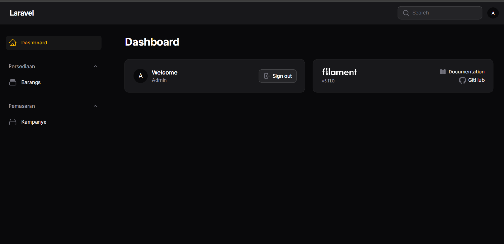
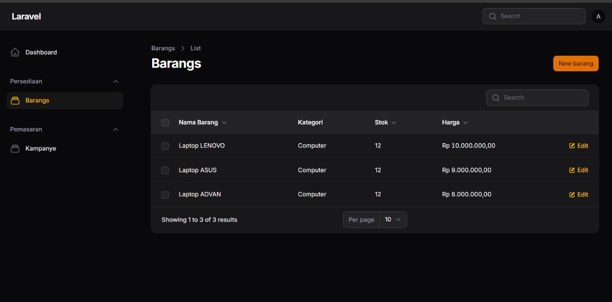
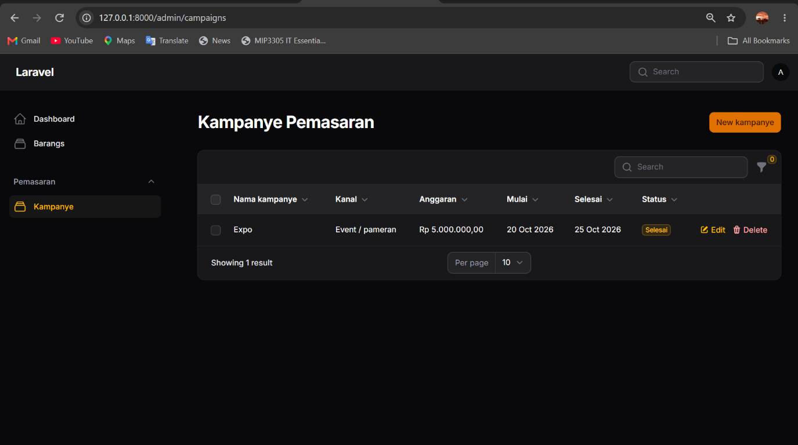

# ERP NeoSantara Group

**Sistem Enterprise — Ujian Tengah Semester (UTS)**

## Struktur Tim dan Pembagian Tugas

| No. | Nama Anggota | Peran | Tanggung Jawab |
|---|---|---|---|
| 1 | Ahmad Yusuf Nainggolan  | Ketua Tim |  pengelolaan repository GitHub, Pengembangan modul pengelolaan stok barang |
| 2 | Desi Afrianti | Anggota | Pengembangan modul kampanye pemasaran  |
| 3 | Suci Rahmadani | Anggota | Pengembangan modul prospek pelanggan |

## Deskripsi Proyek

ERP NeoSantara Group merupakan aplikasi berbasis web yang dikembangkan untuk mendukung transformasi digital pada PT Neosantara Group, sebuah perusahaan distributor dan ritel nasional.

Aplikasi ini dirancang untuk mengintegrasikan proses bisnis perusahaan, mulai dari pencarian prospek pelanggan, pengelolaan kampanye pemasaran, hingga pengelolaan stok barang di gudang dalam satu platform terpadu.

Proyek ini dikembangkan sebagai pemenuhan tugas Ujian Tengah Semester (UTS) mata kuliah Sistem Enterprise, Program Studi Manajemen Informatika, Politeknik Negeri Padang.

## Tujuan

- Mengembangkan platform ERP berbasis web.
- Mempermudah pengelolaan data operasional perusahaan.
- Mendukung pengelolaan stok barang secara terstruktur.
- Menyediakan dasar pengembangan modul prospek pelanggan dan kampanye pemasaran.
- Menerapkan kolaborasi pengembangan perangkat lunak menggunakan Git dan GitHub.

## Teknologi yang Digunakan

- **Bahasa pemrograman:** PHP
- **Framework:** Laravel
- **Admin panel:** FilamentPHP V5
- **Frontend:** Blade dan komponen antarmuka Filament
- **Version control:** Git
- **Repository:** GitHub

## Modul Aplikasi

### 1. Dashboard Admin

Dashboard merupakan halaman utama administrator untuk mengakses fitur-fitur yang tersedia pada aplikasi ERP NeoSantara Group.

**Screenshot:**



### 2. Pengelolaan Stok Barang

Modul ini digunakan untuk mengelola data barang yang berkaitan dengan aktivitas pergudangan.

Fitur yang dikembangkan:
- Menampilkan daftar barang.
- Menambahkan data barang.
- Mengelola nama barang dan kategori.
- Mencatat jumlah stok.
- Mencatat harga barang.
- Mengubah data barang yang tersedia.

**Screenshot daftar barang:**




### 3. Pencarian Prospek Pelanggan

Modul ini dirancang untuk mendukung pengelolaan informasi calon pelanggan sebagai bagian dari proses bisnis perusahaan.

**Screenshot:**


### 4. Kampanye Pemasaran

Modul ini dirancang untuk mendukung pengelolaan data kampanye pemasaran perusahaan.

**Screenshot:**




## Persyaratan Sistem

- PHP yang kompatibel dengan versi Laravel pada proyek.
- Composer.
- Database sesuai konfigurasi aplikasi.
- Node.js dan npm jika diperlukan untuk aset frontend.

## Cara Instalasi dan Menjalankan Aplikasi

### 1. Clone Repository

```bash
git clone https://github.com/mahmedyuu/erp-neosantara.git
cd erp-neosantara
```

### 2. Instal Dependensi

```bash
composer install
```

### 3. Konfigurasi Environment

Salin file `.env.example` menjadi `.env`, kemudian sesuaikan konfigurasi database pada file `.env`.

### 4. Generate Application Key

```bash
php artisan key:generate
```

### 5. Siapkan Database

Pastikan database sudah dibuat dan konfigurasi koneksi database telah sesuai.

Jalankan migration:

```bash
php artisan migrate
```

### 6. Jalankan Aplikasi

```bash
php artisan serve
```

Buka alamat lokal yang ditampilkan pada terminal di browser.

## Version Control dan Kolaborasi

Pengembangan proyek menggunakan Git dan GitHub untuk menyimpan riwayat perubahan kode, mengelola branch, serta mendukung kolaborasi antaranggota tim.

Repository proyek: https://github.com/mahmedyuu/erp-neosantara

## Kesimpulan

ERP NeoSantara Group dikembangkan sebagai solusi awal untuk mengintegrasikan pengelolaan proses bisnis perusahaan melalui aplikasi web. Pengembangan dilakukan secara bertahap dengan fokus pada modul-modul yang mendukung kebutuhan operasional perusahaan, khususnya pengelolaan stok barang, prospek pelanggan, dan kampanye pemasaran.

Aplikasi ini diharapkan dapat menjadi dasar pengembangan sistem ERP yang lebih terintegrasi sesuai kebutuhan PT Neosantara Group.

---

**Mata Kuliah:** Sistem Enterprise  
**Program Studi:** Manajemen Informatika  
**Institusi:** Politeknik Negeri Padang  
**Tahun Ajaran:** 2026/2027